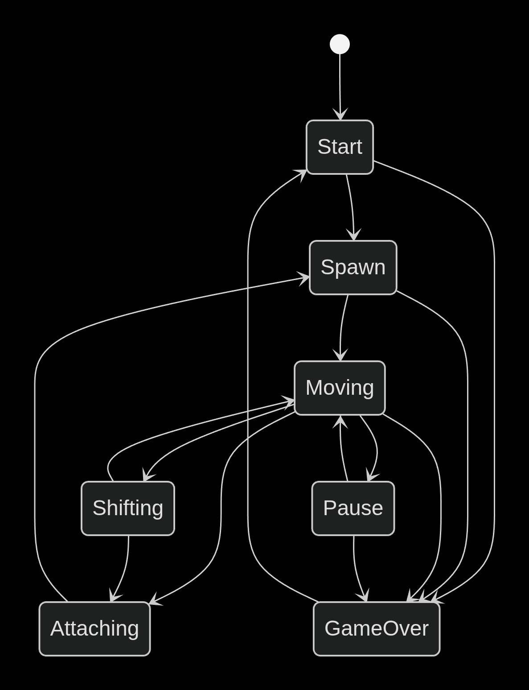

# **BrickGame v1.0 Тетрис**

Реализация игры «Тетрис» на языке программирования C с использованием структурного подхода. Это учебный проект Школы 21.
Проект состоит из двух частей: библиотеки, реализующей логику работы игры, которую можно в будущем подключать к различным GUI, и терминального интерфейса на ncurses.
Логика работы библиотеки реализована с использованием конечного автомата. Обеспечено покрытие библиотеки unit-тестами.

Цель игры — в наборе очков за построение линий из генерируемых игрой блоков. Очередной блок, сгенерированный игрой, начинает опускаться вниз по игровому полю, пока не достигнет нижней границы или не столкнется с другим блоком. Пользователь может поворачивать фигуры и перемещать их по горизонтали, стараясь составлять ряды. После заполнения ряд уничтожается, игрок получает очки, а блоки, находящиеся выше заполненного ряда, опускаются вниз. Игра заканчивается, когда очередная фигура останавливается в самом верхнем ряду.

## **Требования**

- GCC
- make
- ncurses
- check
- lcov
- doxygen
- clang-format

## **Установка и запуск**

Из папки src выполнить:

- make install
- ./games/tetris

## **Управление**

| Клавиша | Действие              |
|---------|-----------------------|
| s       | Начать игру           |
| p       | Пауза                 |
| q       | Выйти из игры         |
| ←       | Движение фигуры влево |
| →       | Движение фигуры вправо|
| ↓       | Ускоренное падение    |
| пробел  | Поворот фигуры        |

## **Механики игры**

В игре присутствуют следующие механики:

- Вращение фигур;
- Перемещение фигуры по горизонтали;
- Ускорение падения фигуры (при нажатии кнопки фигура перемещается до конца вниз);
- Показ следующей фигуры;
- Уничтожение заполненных линий;
- Завершение игры при достижении верхней границы игрового поля;
- В игре присутствуют 7 типов фигур (I, J, L, O, S, T, Z);
- Реализовано начисление очков:
        
        1 линия — 100,
        2 линии — 300,
        3 линии — 700,
        4 линии — 1500;

- Уровень повышается каждые 600 очков (максимум 10);
- С каждым уровнем скорость падения фигур увеличивается на 5%;
- Рекорд сохраняется в файл resources/high_score.txt.

## **Конечный автомат**

Данный КА состоит из следующих состояний:

- Start/Старт — состояние, в котором игра ждет, пока игрок нажмет кнопку готовности к игре.
- Spawn/Спавн — состояние, в которое переходит игра при создании очередного блока и выбора следующего блока для спавна.
- Moving/Перемещение — основное игровое состояние с обработкой ввода от пользователя: поворот блоков/перемещение блоков по горизонтали.
- Shifting/Сдвиг — состояние, в которое переходит игра после истечения таймера. В нем текущий блок перемещается вниз на один уровень.
- Attaching/Соединение — состояние, в которое переходит игра после «соприкосновения» текущего блока с уже упавшими или с землей. Если образуются заполненные линии, то они уничтожаются, и остальные блоки смещаются вниз. Если блок останавливается в самом верхнем ряду, то игра переходит в состояние «игра окончена».
- Pause/Пауза — пауза
- GameOver/Игра окончена — игра окончена.

## **Makefile цели**

| Цель              | Описание                           |
|-------------------|------------------------------------|
| make / make all   | Сборка игры                        |
| make install      | Установка в games/                 |
| make uninstall    | Удаление из games/                 |
| make clean        | Очистка временных файлов           |
| make test         | Запуск unit-тестов                 |
| make gcov_report  | Отчет о покрытии кода              |
| make dvi          | Генерация документации (doxygen)   |
| make dist         | Создание архива distribution/      |
| make format_check | Проверка стиля (Google Style)      |
| make format_fix   | Автоматическое форматирование      |
| make valgrind     | Проверка утечек памяти             |